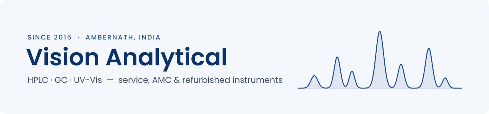

<picture>
  <source media="(prefers-color-scheme: dark)" srcset="assets/banner-dark.svg">
  <source media="(prefers-color-scheme: light)" srcset="assets/banner-light.svg">
  
</picture>

We keep analytical laboratories running. Since 2016, Vision Analytical has supplied, serviced and refurbished chromatography and spectroscopy instruments for labs across Maharashtra and Gujarat.

### What we do

- **Service and repair** for HPLC, GC and UV-Vis systems, with same-day breakdown response
- **AMC and CMC** contracts that keep instruments calibrated and audit-ready
- **Refurbished instruments**, tested and supported, with spares and consumables
- **Qualification and training**: IQ/OQ/PQ, installation and operator training

### Our work

- [Instrument catalogue](https://visionanalytical.co.in/products/): HPLC, GC, LC-MS and UV-Vis systems
- [Service case studies](https://visionanalytical.co.in/case-studies/): real faults and how we fixed them
- [Knowledge base](https://visionanalytical.co.in/blog/): troubleshooting guides and instrument FAQs
- [About us](https://visionanalytical.co.in/about/)

### Contact

Phone +91 91362 16080 &nbsp;·&nbsp; Email [info@visionanalytical.co.in](mailto:info@visionanalytical.co.in) &nbsp;·&nbsp; Web [visionanalytical.co.in](https://visionanalytical.co.in/)

Ambernath, Thane, Maharashtra, India

### Tech we use

Agilent · Waters · Shimadzu · Thermo Scientific · PerkinElmer &nbsp;|&nbsp; HPLC · GC · LC-MS · GC-MS · UV-Vis · FTIR
